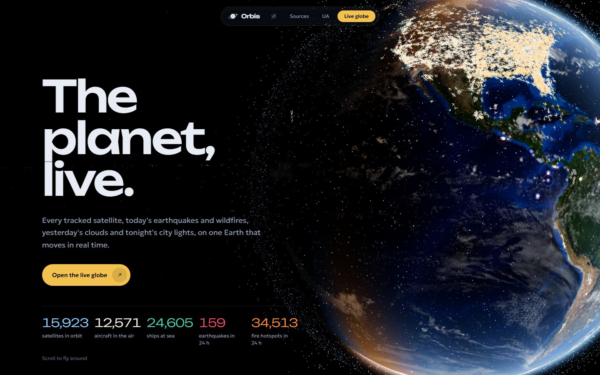
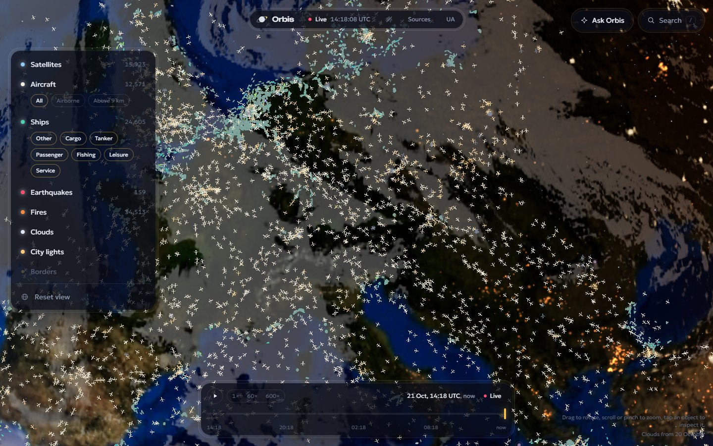
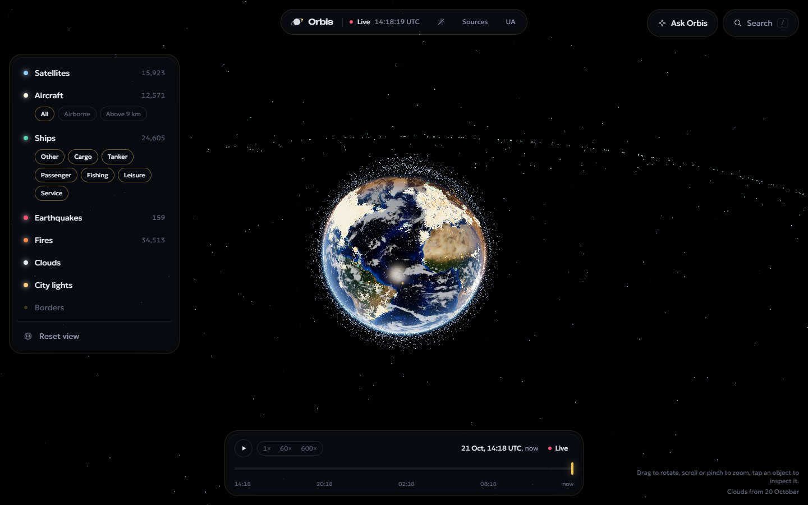
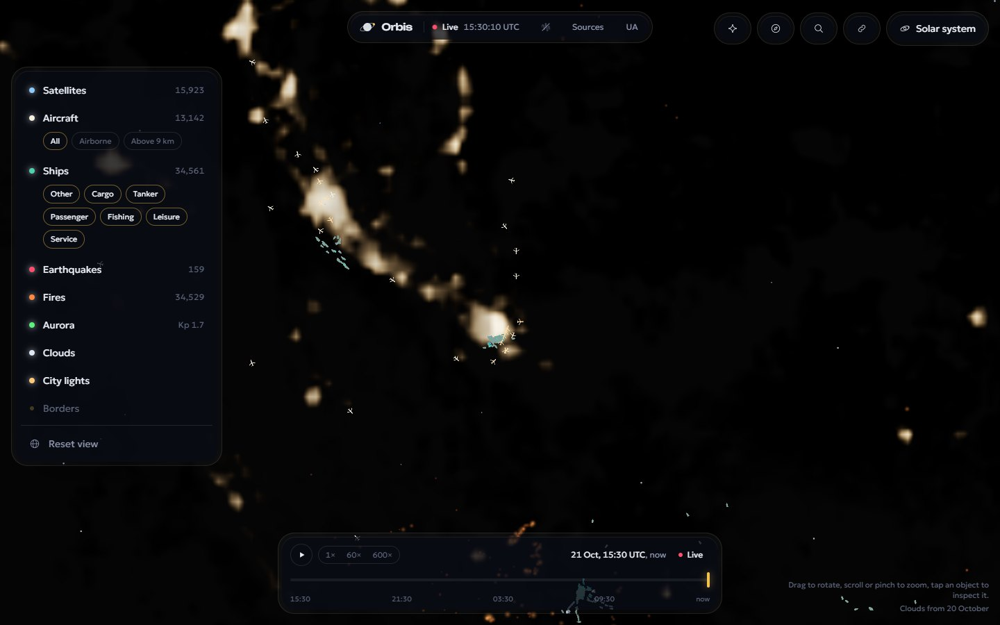
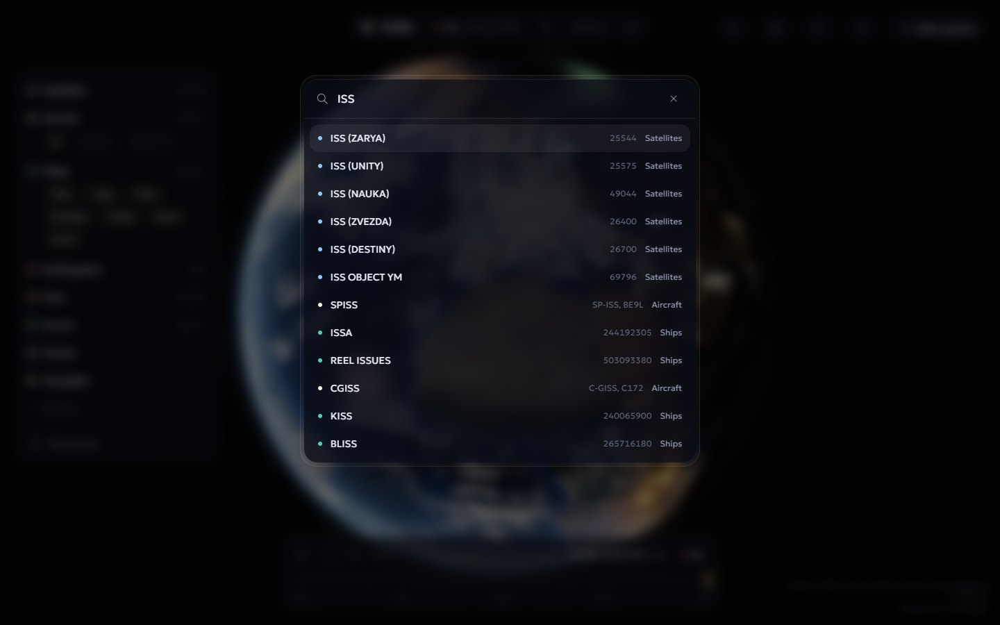
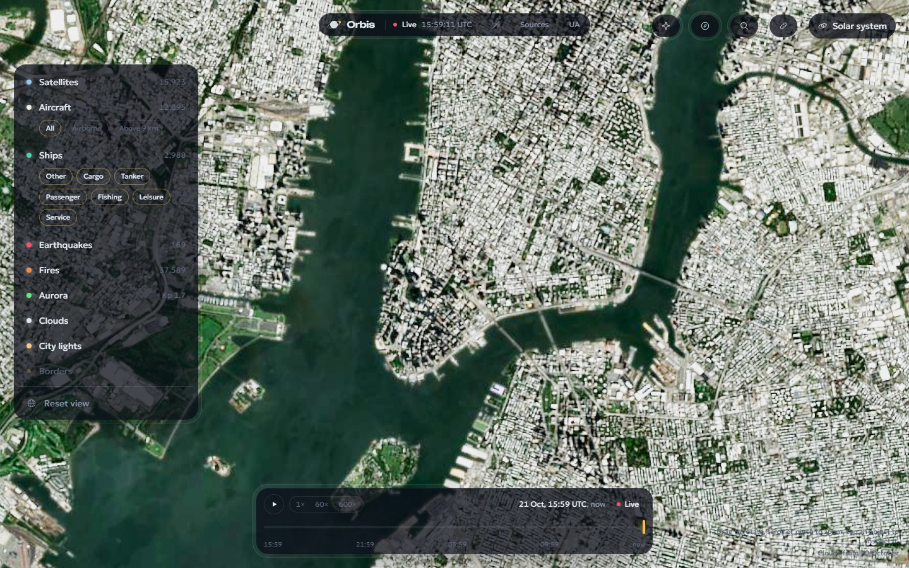
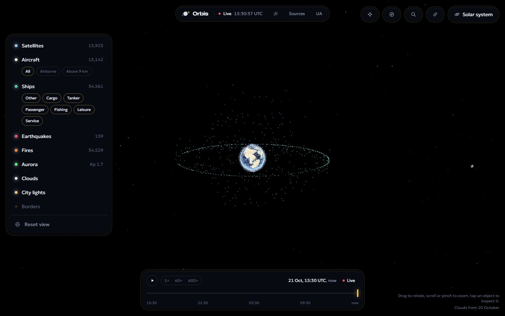
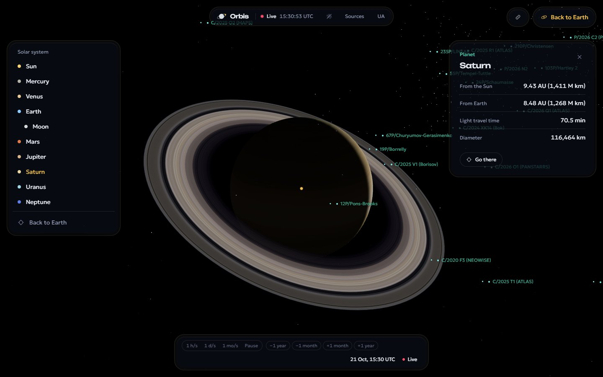
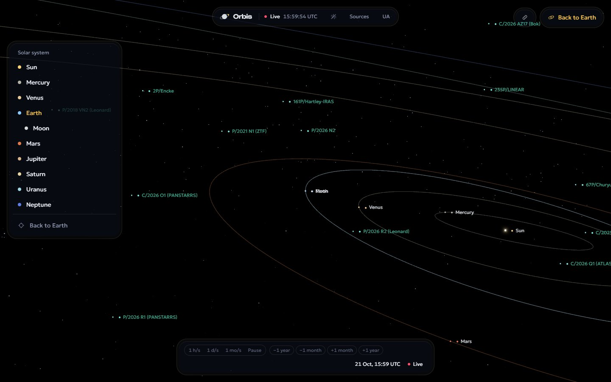
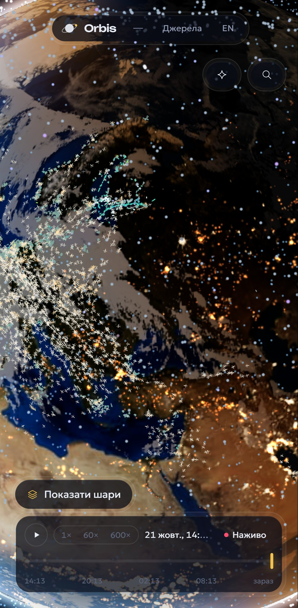

# Orbis

**The planet, live.** A real-time 3D Earth in the browser: every tracked satellite and the ISS, today's earthquakes and
wildfires, yesterday's real clouds and tonight's city lights, on a globe lit by the actual position of the Sun.

Live: https://orbis-live.vercel.app · Case study: https://orbis-live.vercel.app/en/case



[Watch a 25-second flight through the landing tour (WebM)](docs/media/orbis.webm)

| Aircraft over Europe | Satellites and the geostationary ring |
| --- | --- |
|  |  |
| **Ships at Singapore** | **The ISS with its orbit** |
|  |  |

| **Manhattan from 13 km up (Sentinel-2, 10 m)** | **The Moon from 48 Earth radii** |
| --- | --- |
|  |  |
| **The Alps in 3D (Terrarium elevation)** | **Saturn** |
| --- | --- |
|  |  |
| **The inner solar system** | |
|  | |



## What it does

- **Down to the streets.** Imagery streams in as you zoom: Sentinel-2 cloudless (10 m) from EOX for the whole planet
  and, with an ArcGIS Location Platform key, Esri World Imagery down to individual houses. A Web Mercator quadtree
  refines by screen-space error on top of the shaded globe, so lighting, clouds and city lights stay consistent.
- **Out to the planets.** Zoom past the Moon and the scene hands over to a heliocentric view: the Sun, eight planets
  at real size and real positions (JPL elements), the Moon, ~900 large asteroids and famous or currently active
  comets from NASA/JPL, with orbits, labels, close-approach lists and a clock that runs at up to a month per second.
- **Mountains in 3D.** Zoomed in, each tile is raised by real elevation (Mapzen Terrarium, 1.6×) and lit by its slopes; the camera leans toward the horizon as it descends (right-drag, Ctrl-drag, Q/E and R/F turn and tilt it) and never flies into a ridge.
- **Fast streets.** Tiles load target-first: the level the view needs is requested at once, nearest the centre first, 28 at a time over HTTP/2, with stale requests cancelled, images decoded off the main thread and GPU uploads spread over frames. The wheel and pinch zoom toward the cursor and prefetch where the zoom is heading, so a city is already loading before the camera arrives. Elevation comes as 8 KB height grids from the site's own CDN instead of 120 KB PNGs, one grid per 64 tiles. Flights prefetch their destination, and a service worker keeps tiles between visits.
- **Landmarks.** 30 pins with their stories in both languages: the highest, lowest and farthest points of the planet, the deepest hole and the hottest and coldest places, natural wonders, the pads spaceflight started from, and where space rocks struck.
- **Tap anywhere.** Any spot of the globe opens a card with its name (OpenStreetMap), ground height or ocean depth, local time, sunrise and sunset, and the weather now.
- **The real sky.** 5,044 stars at their catalogue positions and colours, the 88 constellation figures, and the Milky Way from Gaia, in both scenes; the planets, Moon and Sun stand among the right stars.
- **Eclipses.** Found in the browser from the site's own ephemerides (checked against NASA's catalogue to a few minutes). The Moon's shadow darkens the Earth and switches on the streetlights in the umbra; the Moon turns red in the Earth's shadow. One button runs the clock through the next eclipses.
- **Your time.** Every clock shows the visitor's time zone ("UTC+3"); a click switches to UTC.
- **Live weather.** RainViewer radar painted over the terrain, refreshed every 10 minutes, and Open-Meteo conditions for your place.
- **The wind, everywhere.** NOAA GFS 10 m wind (decoded from GRIB2, complex packing and all, by the site's own reader) drives tens of thousands of particles on the GPU. Their positions live in a texture, a ring of history slices records their recent path, and each tail is drawn as real line segments on a shell around the planet: sharp at any zoom, glued to the ground, a few milliseconds a frame even on integrated graphics.
- **Tropical cyclones.** Every active storm from GDACS (UN and European Commission): a swirl turning the right way for its hemisphere, sized by its wind and coloured by its alert level, the track it took, the official forecast and the cone of uncertainty. Storms move along their tracks with the timeline; the card gives the category, wind, motion and the countries in its path.
- **A real atmosphere.** Single scattering (Rayleigh and Mie) ray-marched per pixel: blue haze over the disc, a thin limb, sunsets along the terminator, and aerial perspective in tilted views, blended as a veil of its own colour so a sunlit desert keeps its colour.
- **Ride along.** Any satellite, aircraft or ship can be followed: the camera sits behind it at its height, looking along its course.
- **Deep space.** Voyager 1 and 2, New Horizons, JWST, Parker Solar Probe and Europa Clipper from JPL Horizons, with their paths a year behind and ahead.
- **One continuous zoom.** The Earth scene runs out to 400 Earth radii with the Sun, Moon and planets already in the sky, then hands over to the heliocentric scene mid-flight: the camera keeps its distance, direction and easing, data layers thin out long before the switch, labels carry across and the HUD cross-fades, so nothing jumps.
- **Flights between worlds.** Choosing a planet glides the orbit centre from one body to the next while the camera pulls back and dives, instead of cutting. Labels step aside from each other and from the edges of the screen.
- **Guided tour.** One button (or `/live?tour=1`) flies through everything live: the ISS, the busiest sky and sea lanes, the strongest quake of the day, the strongest storm, fires, city lights, the aurora oval, then out past the Moon to Saturn, Voyager 1 and a month-per-second view of the inner solar system, and home. Touching the controls ends it.
- **The Sun, live.** The Sun's card shows SDO's latest AIA 304 Å frame and the solar wind at L1 (speed, field strength, Bz) from NOAA SWPC.
- **Aurora.** NOAA's OVATION forecast drawn as curtains over the night side, with the live Kp index.
- **The sky above me.** The Moon's phase and the planets above the horizon, ISS passes for your place over the next two days (naked-eye visibility included) and what is
  overhead right now: nearby aircraft and satellites high above the horizon.
- **Satellites.** ~16,000 active objects from CelesTrak, propagated with SGP4 in a Web Worker and advanced along their
  orbits on the GPU between updates, so thousands of points move smoothly at 60 fps. Tap one for altitude, speed,
  inclination, period and its orbit drawn around the planet. The ISS is highlighted in gold.
- **Aircraft.** ~12,000 aircraft worldwide from the adsb.lol community network, refreshed every 90 seconds and
  flown along great circles on the GPU in between; each update blends from where an icon was drawn, so nothing jumps.
  Tap one for flight, registration, type, altitude, speed and its track over the last hour.
- **Ships.** Vessels heard on the global aisstream.io AIS feed (a GitHub Action listens for about a minute every
  ten minutes and publishes a snapshot the relay ingests) plus Finland's Digitraffic, coloured by type (cargo, tanker,
  passenger, fishing, leisure, service), with destination, size and a four-hour track. Between snapshots they keep
  moving along their course.
- **Search and filters.** One box (`/` or Ctrl+K) finds satellites, flights, ships, quakes, cyclones and landmarks and flies there;
  aircraft can be filtered by altitude, ships by type.
- **Time machine.** A 24-hour timeline: scrub to any moment or play it back at 60× or 600×. Satellites are
  re-propagated for that instant, the terminator and quakes follow, and aircraft and ships come from 5-minute frames
  the relay records into its Durable Object's SQLite storage.
- **Ask Orbis.** An AI analyst (Gemini, free tier) with tools: it queries live aircraft, ships, quakes, fires and
  satellite positions, answers in Ukrainian or English, and moves the camera or opens the object it talks about.
  Visitors get a daily question allowance enforced by the relay.
- **Earthquakes.** USGS real-time feeds: every event of the past day plus M4.5+ of the week, drawn as rings that ripple
  from each epicentre, coloured by depth and fading with age.
- **Fires.** NASA FIRMS VIIRS (NOAA-20) detections of the last 24 hours, merged into ~4 km cells, sized and coloured by
  radiative power.
- **Clouds.** Yesterday's NASA GIBS true-colour mosaic turned into a cloud mask on the server (bright, colourless and
  brighter than the cloud-free Blue Marble beneath), with real cloud shadows on the ground.
- **Day and night.** A solar ephemeris places the terminator; the night side shows NASA Black Marble city lights, the
  day side uses the Blue Marble image for the current month, with sun glint on water and a scattering atmosphere.
- **Landing tour.** A scroll-driven flight that picks its stops from live data: the strongest quake of the day, the
  busiest fire region, the most populated part of the night side.
- **Shareable views.** The share button copies a link with the camera, time and layers; `/live?at=lat,lon,distance&t=…&layers=…&space=mars`.
- **Sound.** An optional generative ambient bed (Web Audio, no files) with a soft chime on selection.
- **Fast first paint.** The globe appears with 200 KB of maps (preloaded with the HTML) and swaps to 4k in the background.
- **Keyboard.** Arrows turn the globe, + and − zoom, / searches, D shows the frame-time readout.
- **Adaptive quality.** The renderer lowers its pixel ratio when frames run long and restores it when there is headroom.
- Ukrainian and English interface.

## Stack

Next.js 16 (App Router), TypeScript, three.js with hand-written GLSL shaders, satellite.js, GSAP, Zustand,
Tailwind CSS 4, Vitest. Hosted on Vercel; live traffic comes through a relay on Cloudflare Workers (one Durable
Object polling the aircraft feed and ingesting ship snapshots); GitHub Actions mirror CelesTrak data and listen to the AIS stream.

```
src/engine/          renderer, camera rig, simulated clock, layers (incl. imagery tiles, aurora, Moon), shaders, SGP4 worker
src/engine/SolarSystem.ts  heliocentric scene with a floating origin
src/app/api/*        feed routes: fetch upstream once, cache on the CDN, serve everyone
src/lib/             astronomy, geometry, feed parsers, tour logic (unit-tested)
src/i18n/            UA / EN dictionaries
relay/               Cloudflare Worker + Durable Object: aircraft polling, ship snapshots, tracks, history
scripts/             asset pipeline for NASA and Natural Earth imagery, the AIS collector, captures, timings
```

## Data and costs

Everything is free and non-commercial. Visitors never call the data providers directly: each feed is fetched by a
server route and cached on the CDN (USGS for a minute, FIRMS for 30 minutes, clouds for six hours), and CelesTrak,
NOAA GFS and GDACS are read only by a scheduled GitHub Action that keeps small copies on the `data` branch (CelesTrak's
one-download-per-update rule; GRIB2 decoding and the heavy GDACS geometry stay out of visitors' way). Full credits are on the site's Sources page.

| Data | Source | Licence |
| --- | --- | --- |
| Satellites | CelesTrak GP element sets | Free, attribution |
| Imagery | EOX Sentinel-2 cloudless 2024; Esri World Imagery (optional key) | CC BY-NC-SA 4.0; Esri terms |
| Solar system | NASA/JPL SBDB and CAD; planet maps by Solar System Scope | Free; CC BY 4.0 |
| Aurora | NOAA SWPC OVATION, Kp | Public domain |
| Terrain | Mapzen Terrarium on AWS Open Data | Various open (see source) |
| Rain radar, weather | RainViewer; Open-Meteo | Non-commercial; CC BY 4.0 |
| Spacecraft | NASA/JPL Horizons | Public domain |
| Aircraft | adsb.lol | ODbL 1.0 |
| Ships | aisstream.io, Digitraffic (Fintraffic) | Free; CC BY 4.0 |
| Earthquakes | USGS Earthquake Hazards Program | Public domain |
| Fires | NASA FIRMS (LANCE) | Free, attribution |
| Clouds | NASA GIBS | Free, attribution |
| Wind | NOAA GFS (NOMADS) | Public domain |
| Tropical cyclones | GDACS (UN, European Commission JRC) | Free, attribution |
| Stars, constellations | d3-celestial (Yale Bright Star Catalogue) | BSD 3-clause |
| Milky Way | NASA/Goddard SVS Deep Star Maps 2020, ESA/Gaia/DPAC | Free, attribution |
| Place names | OpenStreetMap via Nominatim | ODbL 1.0 |
| Earth imagery | NASA Blue Marble, Black Marble | Public domain |
| Borders | Natural Earth | Public domain |

## Run locally

```bash
npm install
npm run dev
```

`npm run check` runs lint, type checks, unit tests and a production build; `npm run test:e2e` then runs the Playwright
suite (desktop and phone) against that build. `npm run assets` regenerates the textures and
`node scripts/capture.mjs <url>` re-shoots the screenshots, the Open Graph image and the video.

## Roadmap

1. Globe, landing, satellites, quakes, fires, clouds, city lights. *(done)*
2. Live aircraft and ships through a relay, smooth motion for tens of thousands of objects, search, tracks. *(done)*
3. 24-hour history with a replay timeline, an AI analyst that answers questions and moves the camera. *(done)*
4. Mobile polish, sound, end-to-end tests, case study. *(done)*
5. Street-level imagery, the solar system, aurora, sky passes, shareable views. *(done)*
6. Terrain, rain radar, spacecraft, a continuous Earth-to-system hand-over, faster first paint. *(done)*
7. Cinematic flights, a guided tour, the live Sun, labels that never overlap. *(done)*
8. Faster streets, landmarks, tap-anywhere cards, tilted 3D views, the real sky, eclipses, local time. *(done)*
9. Zoom to the cursor, a docked layout, a scattering atmosphere, ride-along, GPU wind, tropical cyclones. *(done)*
